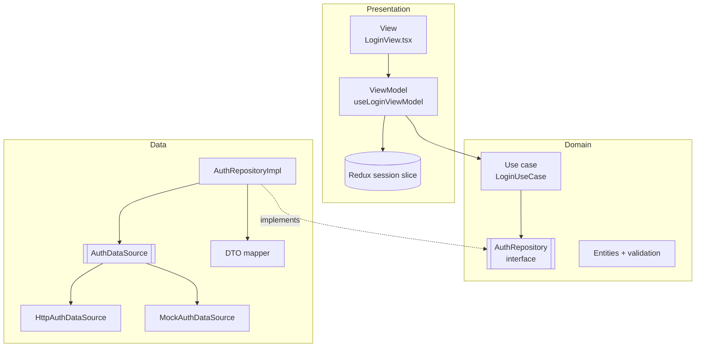

# Feature-based Clean Architecture + MVVM for React Native

[](https://github.com/salarmiirzaeie/featureBased-cleanArchitecture-MVVM-ReactNative/actions/workflows/ci.yml)

A production-style Expo starter that shows how to structure a React Native app so it stays testable as it grows: **feature folders**, **Clean Architecture layers** inside each feature, and **MVVM** in the presentation layer.

The included `auth` feature (login, sign-up, logout, persisted session) is fully implemented and tested. It runs without a backend through an in-memory mock, and it switches to a real API when `EXPO_PUBLIC_API_URL` is set.

**Stack:** Expo 54, React Native 0.81 (New Architecture), TypeScript (strict), Expo Router, Redux Toolkit + RTK Query, redux-persist, NativeWind + Gluestack UI, Jest + React Native Testing Library.

## Architecture



Dependencies point inwards: **the domain imports nothing from React, Redux or HTTP.**

| Layer | Contains | Knows about |
|---|---|---|
| `domain/` | entities, repository interfaces, use cases, validation rules | nothing outside itself |
| `data/` | DTOs and mappers, data sources (HTTP, mock), repository implementations | domain |
| `presentation/` | ViewModels (hooks), Views (components), Redux slice | domain |
| `di.ts` | composition root that wires concrete classes | everything in the feature |

### Key decisions

- **`Result<T, E>` instead of throwing.** Repositories catch transport errors and return typed failures (`ValidationError`, `UnauthorizedError`, `NetworkError`, `UnknownError`). ViewModels branch on `error.kind` and never see HTTP status codes.
- **Views are dumb.** A View renders what its ViewModel returns and forwards events. All form state, validation feedback and side effects live in the ViewModel, which is tested without rendering UI.
- **Routes are thin.** Files in `app/` only connect navigation to feature views, so features stay independent of the router.
- **Features expose a public API** through `features/<name>/index.ts`. Other code imports only from there.
- **Only the session is persisted**, and logging out resets the entire store so no cached data from the previous user survives.

## Project structure

```
app/                          Expo Router routes (thin)
  index.tsx                   redirects based on the persisted session
  auth/login.tsx, auth/signup.tsx, home.tsx
features/
  auth/
    domain/                   User entity, AuthRepository, Login/SignUp/Logout use cases, validation
    data/                     DTO + mapper, Http and Mock data sources, AuthRepositoryImpl
    presentation/             session slice, useLoginViewModel, useSignUpViewModel, views
    di.ts                     composition root
    index.ts                  public API of the feature
    __tests__/                unit tests for every layer
  home/presentation/          HomeView + useHomeViewModel
shared/
  error/                      BaseError hierarchy and Result type
  api/                        RTK Query client (Bearer token from the session)
  store.ts, reducers.ts       store, persistence, reset-on-logout
  ui/                         Gluestack UI components
```

## Getting started

```bash
npm install
npx expo start
```

Log in with the demo account `demo@example.com` / `Password1`, or create a new account (stored in memory until the app restarts).

To use a real backend, copy `.env.example` to `.env` and set `EXPO_PUBLIC_API_URL`. The HTTP data source expects `POST /auth/login`, `POST /auth/register` and `POST /auth/logout`, each returning `{ access_token, user: { id, full_name, email } }`.

## Tests

```bash
npm test
```

| Suite | What it covers |
|---|---|
| `validation.test.ts` | email, password and name rules |
| `usecases.test.ts` | use cases reject bad input before touching the repository, normalize data, pass failures through |
| `data.test.ts` | DTO mapping, HTTP-to-domain error mapping, repository never throws, HTTP and mock data sources |
| `viewmodels.test.tsx` | ViewModels with a real Redux store: success, field errors, form errors, session updates |

## Adding a feature

1. Create `features/<name>/{domain,data,presentation}`.
2. Define entities and a repository interface in `domain/`, then write use cases against the interface.
3. Implement the repository in `data/` (use `api.injectEndpoints` for cached server data).
4. Write a ViewModel hook and a View in `presentation/`.
5. Wire it up in `features/<name>/di.ts`, export the public API from `index.ts`, and add a thin route in `app/`.
